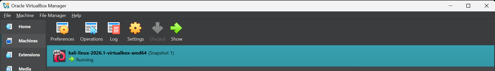
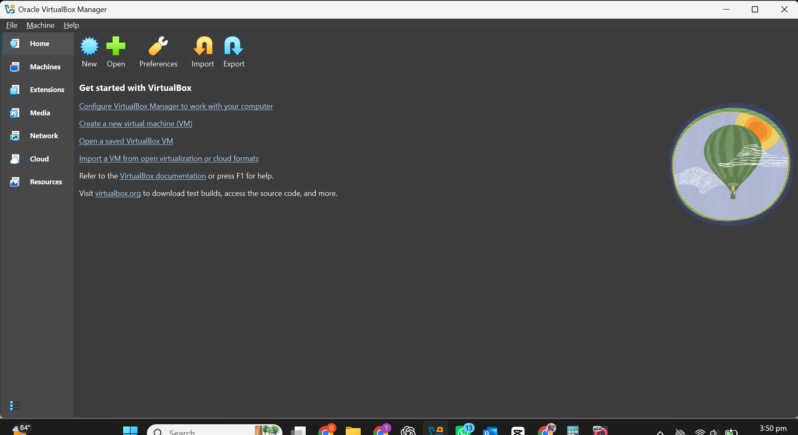
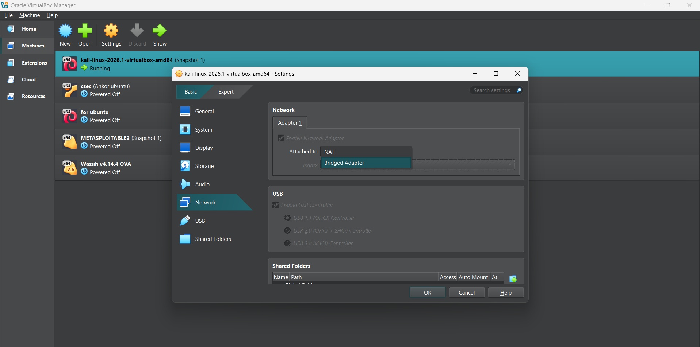

**Building an isolated virtual lab for penetration testing and ethical hacking practice**

# Kali Linux Setup and Configuration

## Project Overview

This project documents my Kali Linux setup and configuration
as part of my Cybersecurity Internship at Networkwalks.

The assignment involved setting up a Kali Linux environment
to support practical cybersecurity learning and laboratory exercises.

## Objectives

- Set up a Kali Linux environment.
- Understand the Kali Linux desktop environment.
- Explore essential Linux commands.
- Verify system information and configurations.
- Prepare a laboratory environment for cybersecurity exercises.

## Tools and Technologies

- Kali Linux
- Oracle VirtualBox (if applicable)
- Linux Terminal
- Virtualization Technology

## Implementation

The assignment involved setting up Kali Linux,
configuring the environment, and verifying that
the system was properly installed and operational.

## Screenshots

Screenshots documenting the setup and configuration
process are available in the Screenshots folder.

## Screenshots

### Kali Linux Desktop Environment

### Terminal Configuration

### System Information

### Network Configuration

## Skills Acquired

- Linux Fundamentals
- Kali Linux Configuration
- Virtual Machine Management
- Basic System Administration
- Cybersecurity Lab Setup

## Acknowledgement

This assignment was completed as part of my
Cybersecurity Internship at Networkwalks.

## Video Demonstration

Watch the video demonstration of my Kali Linux
installation and configuration.

[Click here to watch the Kali Linux Set([YOUR_VIDEO_LINK](https://youtu.be/jWUfxf-ryVc))
